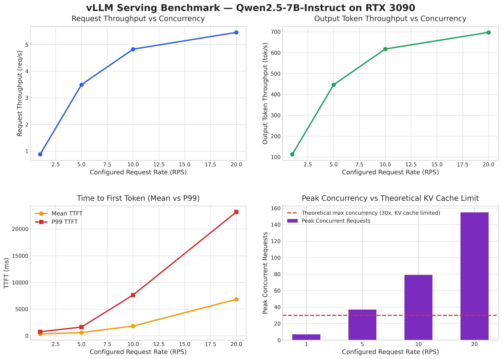
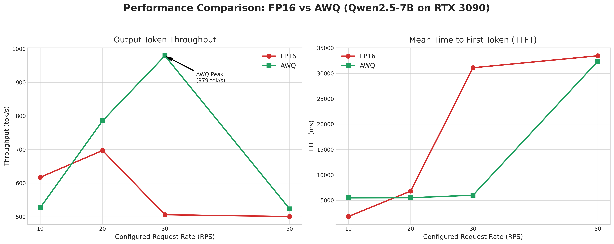

# 🚀 vLLM Serving Benchmark Report: Qwen2.5-7B

本项目记录了使用 `vllm bench serve` 对 **Qwen2.5-7B-Instruct** 模型（包含 FP16 与 AWQ 量化版本）进行压力测试的结果。旨在评估该模型在单机/单卡 vLLM 部署下的吞吐量上限、延迟表现、显存瓶颈，以及量化技术在高并发场景下的实战价值。

## 🖥️ 实验环境 (Test Environment)

*   **模型 (Model):** Qwen/Qwen2.5-7B-Instruct (FP16)
*   **推理框架 (Framework):** vLLM (version 0.33.0)
*   **GPU:** NVIDIA RTX 3090 24GB
*   **CUDA Version:** 12.8
*   **PyTorch Version:** 2.14.0+cu130
*   **测试工具:** `vllm bench serve` (默认输入长度 1024，输出长度 128)

<!-- ### ⚙️ 服务启动命令
```bash
vllm serve Qwen/Qwen2.5-7B-Instruct \
  --host 0.0.0.0 \
  --port 8000 \
  --gpu-memory-utilization 0.90 \
  --max-model-len 4096 \
  --max-num-seqs 64
``` -->

## 📊 压测数据汇总 (Benchmark Results)

### 1. FP16 模型性能指标 (Overall Metrics)
我们使用了不同的请求速率 (Request Rate) 进行了 **6 组** 测试，所有测试均为 **0 失败 (Failed requests: 0)**，服务表现出极高的稳定性。



### 1. 综合性能指标 (Overall Metrics)

| 测试组 | 目标速率<br>(req/s) | 成功请求数 | 实际吞吐率<br>(req/s) | 输出吞吐量<br>(tok/s) | 峰值并发数 | 平均首字延迟 (TTFT) | 平均生成延迟 (TPOT) |
| :--- | :--- | :--- | :--- | :--- | :--- | :--- | :--- |
| **Rate 1** | 1.00 | 20 | 0.88 | 112.72 | 7 | **327.16 ms** | **23.35 ms** |
| **Rate 5** | 5.00 | 50 | 3.49 | 446.24 | 37 | **587.16 ms** | **40.67 ms** |
| **Rate 10** | 10.00 | 100 | 4.82 | 617.38 | 79 | **1815.21 ms** | **64.53 ms** |
| **Rate 20** | 20.00 | 200 | 5.45 | **697.15** | 155 | **6824.76 ms** | **82.02 ms** |
| **Rate 30** | 30.00 | 300 | 3.95 | **505.96** | 300 | **31109.60 ms** | **108.37 ms** |
| **Rate 50** | 50.00 | 300 | 3.91 | **500.51** | 300 | **33461.78 ms** | **109.66 ms** |

### 2. 延迟分位数详情 (Latency Percentiles)

| 测试组 | TTFT P99 | TPOT P99 | ITL 均值 (Mean) |
| :--- | :--- | :--- | :--- |
| **Rate 1** | 741.38 ms | 27.38 ms | 23.35 ms |
| **Rate 5** | 1622.57 ms | 66.58 ms | 40.67 ms |
| **Rate 10** | 7628.66 ms | 105.54 ms | 64.53 ms |
| **Rate 20** | 23193.78 ms | 135.07 ms | 82.02 ms |
| **Rate 30** | 62701.83 ms | 123.72 ms | 108.37 ms |
| **Rate 50** | 67581.16 ms | 124.19 ms | 109.66 ms |

> *注：TTFT = Time to First Token (首字延迟), TPOT = Time per Output Token (单字生成延迟), ITL = Inter-token Latency (Token间延迟)*

### 2. AWQ 量化模型性能指标 (Overall Metrics)


| 测试组 | 目标速率<br>(req/s) | 成功/失败请求数 | 实际吞吐率<br>(req/s) | 输出吞吐量<br>(tok/s) | 峰值并发数 | 平均首字延迟 (TTFT) | 平均生成延迟 (TPOT) |
| :--- | :--- | :--- | :--- | :--- | :--- | :--- | :--- |
| **AWQ - 10 RPS** | 10.00 | 100 / 0 | 4.11 | 526.72 | 100 | 5496.82 ms | 82.14 ms |
| **AWQ - 20 RPS** | 20.00 | 200 / 0 | 6.14 | 785.71 | 149 | 5512.25 ms | 71.79 ms |
| **AWQ - 30 RPS** | 30.00 | 275 / 25 | 7.65 | **979.12** | 186 | 6012.94 ms | 60.32 ms |
| **AWQ - 50 RPS** | 50.00 | 300 / 0 | 4.09 | 523.26 | 300 | 32372.15 ms | 104.83 ms |

> *注：AWQ 在 30 RPS 时达到吞吐巅峰，但出现了部分失败请求；在 50 RPS 时出现明显的性能撞墙。*


## 🔍 FP16 深度性能分析 (Analysis)

### 1. 吞吐量天花板与算力瓶颈

*   随着请求速率从 1 提升至 20，系统的**输出吞吐量**从 `112 tok/s` 跃升至 `697 tok/s`。这证明了 vLLM 的 `Continuous Batching`（连续批处理）技术极大地提升了 GPU 利用率。
*   **性能拐点出现在 Rate 10 到 Rate 20 之间。** 当速率翻倍时，吞吐量仅从 `617 tok/s` 提升至 `697 tok/s` (仅提升约 13%)。这表明 GPU 的算力或显存带宽已经基本饱和，达到了该硬件配置下的吞吐量极限。

### 2. 延迟的恶化与长尾效应

*   **首字延迟 (TTFT) 急剧上升：** 在低并发 (Rate 1) 下，TTFT 仅为 `327ms`，体验极佳。但到了 Rate 20，平均用户需要等待 `6.8秒` 才能看到第一个字，P99 更是高达 `23秒`。这对于实时交互（Chatbot）场景是不可接受的。
*   **P99 数据的长尾现象：** 观察 Rate 10 的数据，TTFT 的中位数 (Median) 仅为 `194.75ms`，但均值 (Mean) 却高达 `1815.21ms`。这说明在中等并发下，绝大多数请求很快，但有极少数请求遭遇了严重的排队阻塞。

### 3. 并发队列与资源抢占

*   服务启动时限制了 `--max-num-seqs 64`。但在 Rate 20 的测试中，**峰值并发数达到了 155**。
*   这说明请求的到达速度（20 req/s）远超 GPU 的处理速度。多出来的请求堆积在 API 层的等待队列中，导致系统整体的排队延迟远大于计算延迟。

### 4. 极限施压下的“性能撞墙”与雪崩效应

当测试继续加压至 **30 RPS** 和 **50 RPS** 时，系统出现了极其明显的“性能撞墙”与雪崩现象：

*   **吞吐量断崖式下跌**：系统的输出吞吐量并未随着并发增加而上升，反而从 20 RPS 时的巅峰 `697 tok/s` 暴跌并停滞在 `500 tok/s` 左右。此时“加量不加价”，反而出现了负优化。
*   **延迟彻底失控**：平均首字延迟（TTFT）从 6.8 秒直接飙升至 **31 ~ 33 秒**，P99 延迟更是达到了夸张的 **60 ~ 67 秒**，服务实质上已处于不可用状态。
*   **根因分析**：由于 FP16 模型权重已占用大量显存，加上 `--max-num-seqs 64` 的限制，在如此高并发下，大量请求堆积在 Uvicorn API 层（客户端记录峰值并发达到 300）。GPU 内部的 KV Cache 满载导致 vLLM 引擎频繁触发 **抢占（Preemption）**，大量请求被踢出显存又重新计算，产生了巨大的额外开销（Overhead），最终导致系统吞吐量雪崩。

## 🥊 FP16 vs AWQ 深度对比分析 (Analysis)


### 1. 逆转点：30 RPS 下的“生死线”

在 FP16 测试中，30 RPS 是系统的“雪崩点”，吞吐量暴跌至 505 tok/s，首字延迟（TTFT）飙升至 31 秒。然而，**AWQ 模型在 30 RPS 时却迎来了吞吐量的巅峰（979.12 tok/s），且平均 TTFT 依然稳定在 6 秒左右。**

*   **原因剖析**：FP16 权重占用约 15GB 显存，留给 KV Cache 的空间极小。当 30 RPS 请求涌入时，KV Cache 瞬间爆满，vLLM 触发极其严重的抢占（Preemption），导致请求反复重算。而 AWQ 权重仅约 5GB，释放了超 10GB 的显存用于 KV Cache，轻松容纳了高并发请求，彻底消灭了抢占带来的性能惩罚。

### 2. 反直觉现象：低并发下 AWQ 反而略慢？

在 10 RPS 时，AWQ 的吞吐量（526 tok/s）和 TTFT（5.49s）均不如 FP16（617 tok/s, 1.81s）。

*   **原因剖析**：这主要归咎于两点。第一，AWQ 引入了解量化（Dequantization）的计算开销；第二，为了解决之前 CUDA 版本导致的 FlashInfer 编译报错，我们在启动 AWQ 时禁用了 FlashInfer 采样器（`VLLM_USE_FLASHINFER_SAMPLER=0`），这导致采样阶段的纯计算速度有所下降。

### 3. 极限天花板：50 RPS 的殊途同归

当压力继续拉满至 50 RPS 时，AWQ 也出现了“撞墙”现象（TTFT 飙升到 32 秒，吞吐量跌回 523 tok/s）。

*   **结论**：这说明在 50 RPS 的极端压力下，即便是 AWQ 也无法抗住如此恐怖的请求排队。RTX 3090 的单卡物理极限在此刻被彻底榨干。但 AWQ 将系统的“可用并发上限”从 20 RPS 硬生生提升到了 30 RPS，这在实际业务中是极具价值的。

### 4. 并发队列与资源抢占的雪崩效应

*   在 FP16 的 Rate 20 测试中，**峰值并发数达到了 155**；而 AWQ 在 30 RPS 时峰值并发达到了 **186**。
*   这说明请求的到达速度远超 GPU 的处理速度。多出来的请求堆积在 API 层的等待队列中，导致系统整体的排队延迟远大于计算延迟。特别需要注意的是，**AWQ 在 30 RPS 时出现了 25 个失败请求**，这通常是因为排队超时或显存极限边缘的崩溃，标志着系统已经到了临界点。

## 💡 结论(Conclusions)

基于上述数据，我们对 Qwen2.5-7B-Instruct 在单卡 RTX 3090 上的部署得出以下结论：

1.  **极限吞吐点对比：**
    *   **FP16 模型：** 绝对吞吐巅峰在 **20 RPS** 左右（约 700 tok/s）。一旦超过 20 RPS，系统将发生资源挤兑，导致延迟暴涨和吞吐量下降。
    *   **AWQ 模型：** 绝对吞吐巅峰在 **30 RPS** 左右（约 980 tok/s），性能提升了约 **40%**。

2.  **场景选型建议：**
    *   **极低延迟场景 (< 5 RPS)：** 优先使用 FP16，其解量化开销小，首字延迟（TTFT）表现更好。
    *   **高并发场景 (10 ~ 30 RPS)：** **必须使用 AWQ**。这是量化模型的主场，能够提供远高于 FP16 的吞吐量和更稳定的延迟表现。
    *   **离线批处理 (Batch)：** 使用 AWQ，在 20~30 RPS 之间跑满，实现最大吞吐量。

3.  **后续优化方向：**
    *   **参数调整：** 在测试中发现 `--max-num-seqs 64` 限制了 GPU 的调度能力。可以尝试将该值调大至 128 或 256，看是否能进一步压榨出 AWQ 的极限并发能力。
    *   **开启 Chunked Prefill：** 添加 `--enable-chunked-prefill` 参数，可以有效缓解长 Prompt 阻塞短 Prompt 的情况，改善高并发下的延迟。