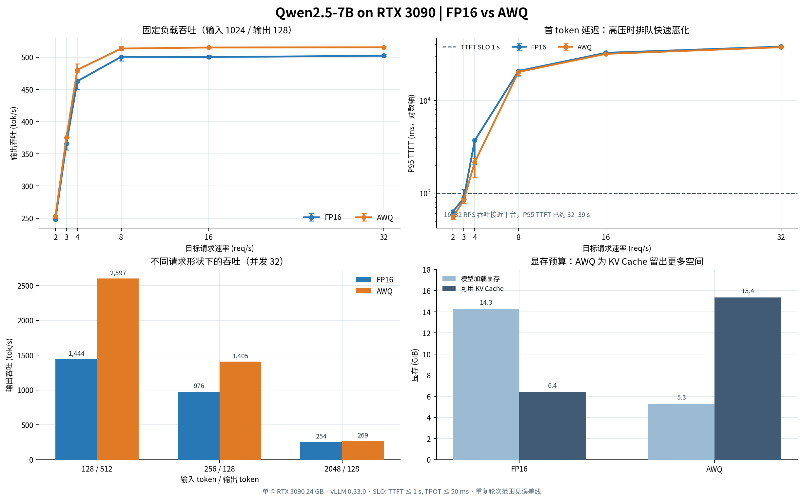

# vLLM Serving Benchmark

**Qwen2.5-7B-Instruct FP16 vs AWQ on a single RTX 3090**

一个面向推理服务评估的可复现实验：使用 vLLM 提供 OpenAI-compatible API，以固定 token 长度的合成请求比较 FP16 与 AWQ，并记录吞吐、尾延迟、SLO goodput、GPU/KV Cache 状态及请求错误。

图表由逐轮测量结果生成；速率曲线的误差线表示重复轮次的最小值至最大值。可查看 [PNG](results/study_20261118/overview.png)、[PDF](results/study_20261118/overview.pdf) 或 [完整汇总表](results/study_20261118/SUMMARY.md)。

## 主要结果

固定负载为 **1024 输入 / 128 输出 token**，每轮发送 192 个请求。吞吐和 P95 TTFT 是各轮测量值的中位数；失败数按所有请求累计。各速率重复 3–5 轮，因此表中 FP16/AWQ 的请求总数不同。Goodput 按 TTFT <= 1000 ms 且 TPOT <= 50 ms 计算。

| 目标速率 | FP16 输出 tok/s | FP16 P95 TTFT | FP16 失败 | AWQ 输出 tok/s | AWQ P95 TTFT | AWQ 失败 |
|---:|---:|---:|---:|---:|---:|---:|
| 2 RPS | 248 | 630 ms | 0 / 576 | 253 | 548 ms | 0 / 768 |
| 3 RPS | 366 | 884 ms | 5 / 576 | 375 | 842 ms | 0 / 576 |
| 4 RPS | 463 | 3,697 ms | 1 / 576 | 480 | 2,159 ms | 2 / 576 |
| 8 RPS | 500 | 20,811 ms | 16 / 576 | 513 | 20,288 ms | 7 / 768 |
| 16 RPS | 500 | 32,658 ms | 0 / 576 | 515 | 31,817 ms | 0 / 768 |
| 32 RPS | 502 | 38,089 ms | 0 / 576 | 515 | 37,545 ms | 0 / 960 |

实验显示，1024/128 负载下输出吞吐在高到达率时进入约 500 tok/s 的平台，而 P95 TTFT 持续恶化；在 3–4 RPS 附近延迟开始超过 1 秒目标。AWQ 在这条速率曲线上的吞吐仅比 FP16 高约 3–4%，没有证据表明它显著移动了延迟拐点。

按上述 TTFT/TPOT 阈值计算，3 RPS 时 FP16/AWQ 的中位 SLO goodput 分别约为 1.6/2.8 req/s；4 RPS 时约为 0/1.0 req/s；8 RPS 及以上均为 0。Goodput 将吞吐和延迟目标结合，避免将过载时的高 token/s 误读为可用容量。

请求形状会显著影响结果。在并发 32、128 输入 / 512 输出场景中，AWQ 中位输出吞吐为 **2,597 tok/s**，FP16 为 **1,444 tok/s**，约高 80%。这是特定负载下的测量，不应泛化到其他输入输出比例。

| vLLM 日志中的显存指标 | FP16 | AWQ |
|---|---:|---:|
| 模型加载显存 | 14.29 GiB | 5.29 GiB |
| 可用 KV Cache 显存 | 6.43 GiB | 15.37 GiB |
| KV Cache token 容量 | 120,464 | 287,808 |

全部实验共完成 64 组、发送 10,816 个请求，其中 44 个请求返回 Bad Gateway（FP16 34 个、AWQ 10 个）。错误均保留在数据中；本次实验没有定位其来源。监控记录的 num_preemptions_total 增量为 0，因此不将观测到的吞吐平台归因于 KV Cache 抢占。

## 实验方法

- **硬件**：NVIDIA GeForce RTX 3090 24 GB；驱动 580.178.04。主机报告 CUDA 13.0，PyTorch 为 2.14.0+cu130；运行环境设置 CUDA_HOME=/usr/local/cuda-12.8。
- **软件**：Python 3.11.7、vLLM 0.33.0、Transformers 5.20.2。FP16 模型 checkpoint 原始权重为 BF16，由 vLLM 转换为 FP16；AWQ 使用 awq_marlin。
- **服务参数**：max-model-len=4096、max-num-seqs=64、max-num-batched-tokens=2048、GPU memory utilization 0.90；启用 chunked prefill、关闭 prefix caching。两模型都关闭 FlashInfer sampler，以固定采样后端。
- **请求**：vLLM random dataset 生成固定长度合成 token 序列，temperature 0、固定输出长度并忽略 EOS。主速率曲线使用 1024/128，每轮 192 请求；形状测试使用并发 32，分别测 128/512、256/128、2048/128，每轮 128 请求。每种长度先发 16 个预热请求。
- **重复和指标**：核心负载重复 3–5 轮，使用受控 seed；每轮内测试顺序随机化。记录 P50/P95/P99 TTFT、TPOT、ITL、E2E、吞吐、goodput、失败数。GPU 和 vLLM Prometheus 指标约每两秒采样一次。

本项目使用合成固定长度请求，便于控制变量和重复对照；它不代表真实用户 prompt 分布，也不是通用服务容量承诺。高 RPS 下的队列延迟与错误应和吞吐一起评估。

## 结果文件

| 文件 | 内容 |
|---|---|
| results/study_20261118/overview.png、overview.pdf | 结果图 |
| results/study_20261118/runs.csv | 64 组逐轮指标、失败数和监控摘要 |
| results/study_20261118/aggregate.csv | 按模型和负载聚合的中位数、最小值、最大值 |
| results/study_20261118/SUMMARY.md | 可快速浏览的完整结果表 |
| results/study_20261118_rerun/、study_20261118_extension/、study_20261118_knee/ | 原始 vLLM JSON、逐请求日志、服务日志、命令、环境和监控记录 |

## 复现

需要 Linux、可用的 NVIDIA GPU/驱动、Python 3.11、uv，以及 Hugging Face 缓存中的两个模型。运行器默认从 ~/.cache/huggingface/hub 读取固定 revision，并在离线模式下启动：

    uv venv vllm-lab --python 3.11
    uv pip install --python vllm-lab/bin/python "vllm==0.33.0" matplotlib numpy
    uv pip install --python vllm-lab/bin/python huggingface_hub

    vllm-lab/bin/hf download Qwen/Qwen2.5-7B-Instruct \
      --revision a09a35458c702b33eeacc393d103063234e8bc28
    vllm-lab/bin/hf download Qwen/Qwen2.5-7B-Instruct-AWQ \
      --revision b25037543e9394b818fdfca67ab2a00ecc7dd641

先用较小的速率子集验证本机环境：

    vllm-lab/bin/python scripts/run_study.py \
      --minutes 30 \
      --configs fp16 awq \
      --rates 2 3 4 \
      --repetitions 2 \
      --rate-only \
      --output results/reproduction

    python scripts/summarize_study.py results/reproduction \
      --output results/reproduction/summary

    python scripts/plot_results.py \
      --data results/reproduction/summary/runs.csv \
      --results-root results/reproduction \
      --output results/reproduction/summary/overview.png

运行时间取决于 GPU 和模型启动/编译时间。运行器会拒绝覆盖已有 --output 目录；用不同路径保存新实验。绘图脚本会从实验目录下的服务日志读取显存数据。

## 工具脚本

- [scripts/run_study.py](scripts/run_study.py)：启动本机 vLLM 服务、预热、执行 benchmark，并采集 GPU/Prometheus 指标。
- [scripts/summarize_study.py](scripts/summarize_study.py)：从一个或多个实验目录汇总原始 JSON，输出逐轮 CSV、聚合 CSV 和 Markdown 表。
- [scripts/plot_results.py](scripts/plot_results.py)：从逐轮 CSV 生成图表 PNG/PDF。
